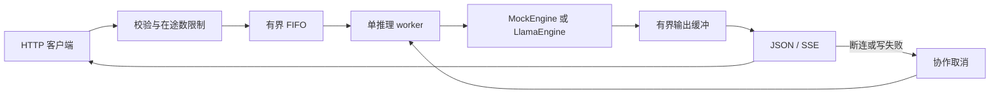

# LLMServe-Lite

面向资源受限 CPU 的轻量 C++ 文本生成服务。使用 llama.cpp 进程内推理，自己实现 HTTP / SSE、有界队列、单推理 worker、取消、超时、背压和指标。

**已完成真实 Qwen2.5-0.5B-Instruct Q4_K_M CPU 推理验收。** 真实性能、测试结果和测量边界见 [测试报告](docs/测试报告.md)；MockEngine 指标单独列出。

## 本地 CPU 稳定版

补齐真实 1/2/4/6 线程、长短输入、输出上限、并发、取消/超时和十分钟稳定性验证。最终证据见 [CPU 扩展验收](docs/CPU扩展验收.md)，原始短提示词测量保留为历史结果，不混作同一二进制或同一工作负载。

```bash
python3 bench/cpu_matrix.py --soak-seconds 600
```

[学习指南](docs/学习指南.md) 解释请求调用链、锁、资源所有权和测量口径。GitHub CI 自动运行不需要模型的 Mock/Sanitizer 检查；真实 CPU 测试依赖本地模型，不冒充云端测试已执行。当前未安装 Docker，未完成容器运行验收。

## 技术栈与架构

- C++17、CMake、pthread，WSL2 Ubuntu 24.04 / GCC 13.3 / CMake 3.28 验证。
- llama.cpp b6500，固定提交 `a7a98e0fffed794396b3fbad4dcdbbc184963645`，只使用 CPU。
- cpp-httplib v0.18.1、nlohmann/json v3.11.3；Python 标准库用于测试和基准。



模型和 context 只加载一次，推理由单线程拥有，每轮清理 KV 状态。接入并发通过排队和拒绝控制，不创建多个模型副本。[架构细节](docs/架构.md) · [API](docs/API.md)

## 编译与自动化测试

需要已有 G++、CMake、Make、Git、Python3。仓库附带两个小型 header-only 依赖及许可证；不包含模型权重、构建产物或完整 llama.cpp 源码。

```bash
# 在克隆后的项目根目录操作
bash scripts/check.sh mock
```

真实 CPU 后端需要准备固定版本的 llama.cpp。当前开发目录已有源码时跳过此步；新的 clone 可执行：

```bash
git clone --depth 1 --branch b6500 https://github.com/ggml-org/llama.cpp third_party/llama.cpp
test "$(git -C third_party/llama.cpp rev-parse HEAD)" = a7a98e0fffed794396b3fbad4dcdbbc184963645
bash scripts/check.sh cpu
```

必须确认提交匹配后再构建；获取失败时停止，不替换成其他版本。也可从 `dependencies.lock.json` 指定的官方归档准备源码，先核对归档 SHA-256，再解压到同一路径。CMake 本身不会自动联网获取依赖。

Release 最多使用两个编译任务；内存紧张可手动改用 `cmake --build build/cpu -j1`。应用 ASan/UBSan 检查使用单路 Debug 构建：

```bash
bash scripts/check.sh sanitize
```

CPU CTest 包含核心、HTTP、离线下载流程和真实模型测试。没有本地校验通过的权重时，真实模型项目显示 **Skipped**；不能把跳过当作真实验收通过。

## 模型准备

仅使用官方 `Qwen/Qwen2.5-0.5B-Instruct-GGUF` 的 `qwen2.5-0.5b-instruct-q4_k_m.gguf`。

- Revision：`9217f5db79a29953eb74d5343926648285ec7e67`
- 字节数：`491400032`
- SHA-256：`74a4da8c9fdbcd15bd1f6d01d621410d31c6fc00986f5eb687824e7b93d7a9db`
- 官方仓库许可证：Apache-2.0。权重不纳入 Git。

可运行 `python3 scripts/fetch_model.py`；脚本固定 revision、限制文件体积并核对官方 SHA-256，不修改代理/DNS，不关闭 TLS 验证。网络不可用时，可以用 Windows 浏览器从[固定官方地址](https://huggingface.co/Qwen/Qwen2.5-0.5B-Instruct-GGUF/resolve/9217f5db79a29953eb74d5343926648285ec7e67/qwen2.5-0.5b-instruct-q4_k_m.gguf?download=true)下载，再将完整文件复制到 `models/`。

```bash
sha256sum models/qwen2.5-0.5b-instruct-q4_k_m.gguf
python3 scripts/fetch_model.py  # 已有完整文件时重新校验，不重复下载
```

`models/manifest.json` 记录本次验收的文件身份；新的 clone 不包含权重，仍需实际下载并核对本地文件。本项目的实际文件已在 Windows 和复制后的 WSL 中分别核对完整 SHA-256。

## 运行

```bash
bash scripts/start.sh mock   # 无需模型的服务层演示
# 或
bash scripts/start.sh cpu    # 需要已准备并校验的模型
```

只绑定 `127.0.0.1:8080`；Ctrl+C 关闭。端口冲突时修改项目配置，不结束其他项目的进程。

```bash
curl http://127.0.0.1:8080/healthz
curl http://127.0.0.1:8080/metrics
curl -N http://127.0.0.1:8080/v1/completions \
  -H 'Content-Type: application/json' \
  -d '{"prompt":"你好，请用一句话介绍你自己。","max_tokens":32,"stream":true}'
```

成功 SSE 包含 delta、done 与唯一 `[DONE]`。流开始后出错通过 error 事件结束；客户端不能只看 HTTP 200 判断成功。队列或接入容量满返回 429，输入非法为 400，排队/执行超时在响应头前返回 504。[完整协议](docs/API.md)

## 默认资源配置

| 参数 | 默认值 |
|---|---|
| 常驻模型 / context / 推理 worker | 各 1 |
| CPU 线程 / context | 4 / 1024 tokens |
| 单请求输出上限 | 128 tokens |
| 等待队列 / 事件缓冲 | 4 / 每请求16项 |
| HTTP 线程 / 生成在途上限 | 8 / 5 |
| 排队 / 执行 / 背压期限 | 30秒 / 120秒 / 2秒 |

真实输入按 chat template 后的 token 数检查上下文预算。greedy 采样；不提供温度、seed、持久会话或多租户接口。MockEngine 的固定中文片段不是模型生成，其字符估算不能代替真实 tokenizer。

## 复现测量

```bash
python3 bench/validate_real.py  # 新进程首次请求 + 20次后续真实 CPU 请求
python3 bench/run.py --samples 24 --output results/mock-benchmark.json
python3 bench/run.py --soak-seconds 1800 --max-tokens 16 --output results/mock-soak.json
```

真实测量脚本记录每次 TTFT、实际输出 token 数、decode 阶段墙钟速度、峰值 RSS、进程 Swap 和成功/失败。启动的临时服务会在结束时自动关闭。原始日志留在本地 `results/`，公开整理数据位于 [docs/benchmarks](docs/benchmarks/)。

“首次请求”指新进程，不清空操作系统页缓存；模型加载到就绪与客户端 TTFT 分开报告。decode 时间包含采样与回调，不宣称为纯算子速度。[测量口径](docs/性能测量.md)

## 真实性能记录

i5-9400、4个CPU推理线程、1024-token context、单客户端。固定输入在模板后为15 tokens，输出上限32，实际每次在14 tokens后遇到EOS结束。两轮均使用同一CPU二进制，不是一次代码优化的前后对比。

| 测量 | 新进程首请求TTFT ms | 后续TTFT p50 ms | 后续TTFT p95 ms | 后续decode速度中位数 tokens/s | 峰值RSS MiB | 成功 |
|---|---|---|---|---|---|---|
| 轮次1 | 202.26 | 142.30 | 291.38 | 24.66 | 562.55 | 21/21 |
| 轮次2 | 103.51 | 101.84 | 123.42 | 34.23 | 562.73 | 21/21 |

每轮1个首请求加20个后续请求，进程Swap峰值均为0。两轮波动保留在报告中；未隔离后台负载或清空OS页缓存，不承诺固定速度。详细定义和逐请求数据见[测试报告](docs/测试报告.md)。


## 目录

```text
include/         配置、引擎、Job、Scheduler 接口
src/             HTTP、调度、引擎与日志实现
configs/         可公开的 mock / CPU 默认配置
tests/           核心、HTTP、离线下载与真实模型检查
bench/           模拟基准、真实 CPU 测量
scripts/         构建检查、启动、单模型下载
third_party/     小型头文件、许可证与固定依赖说明
models/          仅 manifest 纳入 Git，权重本地保存
docs/            架构、API、测量口径和验收结果
results/         本地原始结果，不纳入 Git
```

## 验证范围与限制

- 已验证短输入、单 CPU worker 的真实生成与 SSE；不代表长上下文、大模型或多 worker 的性能。
- 真实模型 30 分钟稳定性、线程2/6对比、真实模型并发性能矩阵、GPU 和 Windows 原生构建尚未验证。
- 此前30分钟稳定性使用 MockEngine，不能替代真实模型的长期运行验证。
- 流式写入失败会触发取消；排队或首输出之前的断连可能要等期限回收。内核发送缓冲会影响慢客户端检测时机。
- 单次基准不消除后台负载与系统换页影响；保留波动，不只挑最好数据。
- 仅本地服务，无鉴权/TLS/公网生产验收；小模型输出不作为回答准确性评测。

应用代码 MIT；第三方许可证和版本见 [依赖说明](third_party/README.md) 与 `dependencies.lock.json`。
