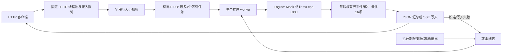

# 架构与资源所有权

模型和 context 在启动时加载，服务成功绑定端口前即完成初始化；推理开始后只由 worker 使用。worker 结束并 join 后才能销毁引擎。`LlamaEngine` 用 RAII 管理 backend、模型、context 和每轮 sampler；decode 回调退出前清除 abort callback，避免悬空函数指针。

`Scheduler` 拥有等待队列和 active Job。Job 由 shared_ptr 保证跨 handler / worker / stream 的存活；原子取消标志跨线程可见，其原因及事件队列由 Job mutex 保护。HTTP 参数不传入 shell，不作为模型路径；日志不记录提示词正文。

锁顺序为 Scheduler mutex → Job mutex。worker 调用引擎时不持有 Scheduler mutex；事件缓冲等待用条件变量释放 Job mutex。单 worker 保证 FIFO 的实际执行次序，不通过多个 context 争抢同一 CPU。并发接入主要验证排队与拒绝行为，不等于并行解码。

Job 使用 running、done 和 cancelled 标志表示生命周期：排队 → 开始执行 → 一个终态。终态事件独立保存，不占有限的 delta 缓冲，避免错误结束被满缓冲卡住。Job::finish 幂等，终态至多被消费一次；排队取消任务在调度或再次接入时清理。

SSE 返回响应头前等待任务开始及第一项结果，因此分词超限或启动生成失败可以使用真实 HTTP 错误码。首个有效 delta 之后发生的错误通过 `event: error` 结束，不能再修改已发出的 200。跨 token 的 UTF-8 字节暂存至完整字符再发出，非法序列替换为 U+FFFD。

进程信号处理函数仅设置 lock-free 原子标志；监视线程发起 Scheduler 停止、取消排队/运行任务、join worker，并停止监听。引擎在分块 prefill、decode 回调和 token 边界检查取消；底层系统调用或驱动异常不能保证在任意时间点强制中断。

HTTP 线程固定 8、生成在途数最多 5、库内部等待任务队列最多 8、等待推理队列最多 4；每个请求最多 16 项输出事件。单请求输出上限与请求体上限共同约束内存。HTTP 接入层拒绝会返回 429；这部分拒绝未进入 Scheduler，因此 Scheduler rejected 计数不包含所有接入层 429，压测应以客户端状态计数为准。

模型下载与服务运行分离。服务不隐式联网、下载模型或升级依赖；CMake 配置基于随项目准备好的固定源码完成，不使用网络 FetchContent。
